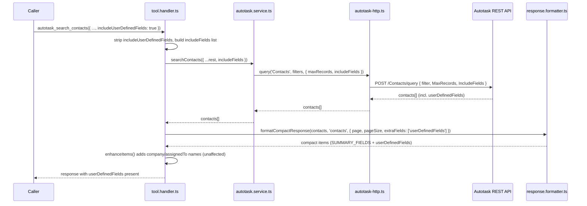

# PRD-20317 · [Feature] Add custom-field return support

Ticket: https://app.clickup.com/t/86e3p4a3z
Repo: https://github.com/MSPbotsAI/autotask-mcp@main (9700dde)
Work branch: dev01.mbagent/PRD-20317
Status: frozen @ b1b9b6a

## Requirement understanding

One line: Add support for returning contact custom fields from the Autotask MCP tool `autotask_search_contacts`, so downstream workflows can use those values directly from the same response without needing an extra lookup call.

The reporter (Felix.Zhou@mspbots.ai, filed 2026-10-12) wants `autotask_search_contacts` to include each matched contact's Autotask custom fields (user-defined fields) in the same tool response, so callers can act on that data without a follow-up lookup. The request is explicitly scoped to this one tool's response shape — not a broader redesign of the Autotask contact tooling. No workaround exists today. Reporter confirmed the solution preview "as-is" (ticket `text_content`, Solution Preview section).

## Current state (every claim carries path:line)

Code Project was empty on this ticket. No ticket text uniquely named a repo, so the `autotask_search_contacts` string itself was used to probe every repo resolvable from the `Code Project` field — zero hits everywhere except one repo not yet registered as a field option. That repo, `https://github.com/MSPbotsAI/autotask-mcp` (checked out at `main` / `9700dde`), is an MCP server wrapping the Autotask REST API, one of a family of per-vendor `*-mcp` repos (`chargebee-mcp`, `bamboohr-mcp`, `halopsa-mcp`, etc.) that already are `Code Project` options. The field option was added by a human on 2026-10-13/14 (see Ticket thread) and the Code Project field now reads this repo.

Within that repo (re-verified against the current `main` HEAD `9700dde` on this tick — identical to the investigation done when the repo was first identified, no drift):

- `autotask_search_contacts` is declared in `src/handlers/tool.definitions.ts:311-331`. Its `inputSchema` has `searchTerm`, `companyID`, `isActive`, `page`, `pageSize` — no field-selection parameter of any kind.
- The handler (`src/handlers/tool.handler.ts:889-891`) calls `s.searchContacts(a)` and passes the raw args object straight through with no filtering.
- `searchContacts()` (`src/services/autotask.service.ts:328-358`) builds an Autotask filter and calls `http.query<AutotaskContact>('Contacts', filters, { maxRecords: pageSize })` — it never sets `opts.includeFields`. The underlying Autotask REST query only returns a contact's `userDefinedFields` when the caller explicitly lists it in the request's `IncludeFields` (`src/services/autotask-http.ts:390-404`, the `IncludeFields` pass-through at lines 400-402). Since `searchContacts()` never asks for it, Autotask never returns it, independent of anything downstream.
- Even if it were returned by Autotask, the compact-response formatter would still drop it: `SUMMARY_FIELDS.contacts` (`src/utils/response.formatter.ts:27`) is a hardcoded allowlist `['id', 'firstName', 'lastName', 'emailAddress', 'companyID']`, and `pickSummaryFields()` (`src/utils/response.formatter.ts:34-55`) only copies those fields onto the response item (`autotask_search_contacts` is in `COMPACT_SEARCH_TOOLS`, `src/utils/response.formatter.ts:115-121`). There are two independent gates, not one.
- This is not an oversight unique to contacts — it is a documented, deliberate platform-wide decision. `CHANGELOG.md:661` (the `[1.0.4]` entry) records that `userDefinedFields` were removed from ticket search responses specifically to stop "result exceeds maximum length" errors. Any fix here has to stay opt-in rather than reverting that decision by default.
- `AutotaskContact` (`src/types/autotask.ts:23-35`) has no `userDefinedFields` field in its type, unlike `AutotaskTicket` (`src/types/autotask.ts:67`: `userDefinedFields?: AutotaskUserDefinedField[]`) — a typing gap only; the index signature `[key: string]: any` means it isn't a runtime blocker.
- Read/write asymmetry already exists for this exact entity: `autotask_update_contact` **already** accepts and forwards `userDefinedFields` (`{name, value}[]`) per `CHANGELOG.md:95` — "the handler already forwarded all args, so only the schema needed the addition" (schema at `src/handlers/tool.definitions.ts:444-454`, handler at `src/handlers/tool.handler.ts:895-897` calling `s.updateContact(a.id, a)` with the full args object). Only the search/read path is missing the capability the ticket asks for.
- `searchContacts()` types its options as `AutotaskQueryOptions` (`src/types/autotask.ts:671-680`), which has no `includeFields`. Most other search methods (`searchTickets`, `searchCompanies`, 20+ others, see `src/services/autotask.service.ts`) already use the richer `AutotaskQueryOptionsExtended` (`src/types/autotask.ts:683-698`), which **does** declare `includeFields?: string[]` — but nothing in `tool.definitions.ts` currently exposes `includeFields` as an MCP-facing parameter for any entity, so there is no existing end-to-end example of wiring a caller-supplied field list through to Autotask. This would be new wiring, not a copy of an existing one.
- The generic compact-response call site (`src/handlers/tool.handler.ts:1677-1684`) already has `args` in scope when it calls `formatCompactResponse(result, entityType, { page, pageSize })` — so a caller-supplied flag on `args` is reachable at the one place that currently strips custom fields back out.
- `SUMMARY_FIELDS` (`src/utils/response.formatter.ts:24-32`) is a module-private `const`, not exported — the handler cannot currently reuse the contacts field list without either exporting it or duplicating it.
- There is no existing MCP tool that already returns a single contact's full record (`autotask_get_contact` does not exist as a tool); `getContact()` (`src/services/autotask.service.ts:317`) is an internal service method used only for an internal `companyID` lookup fallback, not exposed to callers.

wiki: queried as a source (S2b). `autotask-mcp` is an internal MCP tool server, not a user-facing product surface described in `MSPbotsAI/mbagent-wiki` `ProductDocs/**` (that library documents agent.mspbots.ai UI behavior). `mbp.py wiki find` for `autotask`, `custom field`, `autotask_search_contacts`, `contacts`, `autotask connector` returned no section covering this tool's response-payload internals. The one relevant hit: `ProductDocs/15-Capabilities.md § Connector detail view` records that Autotask is a connected MCP connector exposing **98** tools dynamically through the connector gateway (_verified_ 2026-08-27, v4.1.490) — confirming `autotask_search_contacts` is reached through that generic connector surface, which has no knowledge of or opinion on this tool's own response shape. Noted here per S2b rather than silently skipped: **wiki 未覆盖** the specific behavior of this tool's custom-field return.

## Product design

### Goals / Non-goals

**Goals:**
- `autotask_search_contacts` can, on request, return each matched contact's Autotask custom fields (user-defined fields) in the same response, eliminating the need for a separate follow-up lookup.
- Default behavior for every existing caller (anyone not passing the new parameter) is completely unchanged — same fields, same response shape, same response size.

**Non-goals:**
- No broader redesign of the Autotask contact tooling (explicitly ruled out by the ticket's own scope statement).
- No new standalone tool for fetching a single contact's custom fields.
- No change to `autotask_update_contact`'s already-existing custom-field write path — it already works (`CHANGELOG.md:95`).
- No generic, arbitrary field-picker across all search tools (e.g. not implementing a free-form `includeFields` passthrough for every entity) — scoped to this one tool's custom fields only.
- No validation or enumeration of which custom fields exist on a given tenant's Autotask instance — custom fields are tenant-configured in Autotask itself; the tool returns whatever Autotask reports for the matched contact, nothing more.

### Acceptance criteria AC1..AC6

- **AC1**: Given a caller invokes `autotask_search_contacts` without `includeUserDefinedFields` (or with it explicitly `false`), When the search returns matched contacts, Then no item in the response contains a `userDefinedFields` key and the response is otherwise identical in shape to today's.
- **AC2**: Given a contact has one or more Autotask custom fields set, When `autotask_search_contacts` is called with `includeUserDefinedFields: true`, Then that contact's item in the response includes a `userDefinedFields` array with that contact's actual name/value pairs.
- **AC3**: Given a contact has no custom fields set in Autotask, When `autotask_search_contacts` is called with `includeUserDefinedFields: true`, Then the call does not error and that contact's item does not contain fabricated `userDefinedFields` data (key absent or an empty array).
- **AC4**: Given `includeUserDefinedFields: true`, When `autotask_search_contacts` returns matched contacts, Then every field normally present in the response today (`id`, `firstName`, `lastName`, `emailAddress`, `companyID`, and the enhanced `company` name when resolvable) is still present and unchanged — turning the flag on must not remove or alter any existing field.
- **AC5**: Given `includeUserDefinedFields: true`, When the search matches zero contacts, Then the tool returns the existing empty-result shape (`0` items, `"Found 0 contacts"`) without error.
- **AC6**: Given a caller filters by `companyID` and passes `includeUserDefinedFields: true`, When `autotask_search_contacts` runs, Then only contacts belonging to that `companyID` are returned (with their custom fields) — the new flag does not relax or bypass the existing company-scoping filter and cannot be used to retrieve another company's contacts or their custom fields.

### Open questions

- [已假设] Whether Autotask's REST `IncludeFields` query parameter is strictly restrictive (overrides the default field set, returning *only* the listed fields) or additive (adds onto a default set) is not confirmed anywhere in this repo — no existing caller sets it today (see Current state). This design assumes the safer "restrictive" interpretation and always sends the full base-field list (the same list as `SUMMARY_FIELDS.contacts`) plus `userDefinedFields` explicitly, so the result is correct under either interpretation (see Tech design § Non-functional). If this assumption turns out to be wrong in some other way (e.g. Autotask silently ignores unknown field names, or caps the field count), that would surface during the dev leg's self-test against a real Autotask zone, not before — flagging so it is not mistaken for a confirmed fact.
- [不阻塞] The exact wording of the compact-response `hint` field (whether it should mention the new flag) is left to dev's judgement during implementation — it does not change any of the ACs above.
- [不阻塞] Whether other Autotask search tools (companies, tickets, etc.) would benefit from the same opt-in custom-field pattern is out of scope here — the ticket is explicitly scoped to `autotask_search_contacts` only (see Non-goals). A follow-up ticket should be filed if that need shows up.

## Tech design

### Conclusion

Add one opt-in boolean parameter, `includeUserDefinedFields`, to `autotask_search_contacts`'s schema. Wire it through the handler → `searchContacts()` → the Autotask query's `IncludeFields`, and thread a matching `extraFields` override through the existing generic compact-response formatter so the already-fetched `userDefinedFields` survive the compact-field allowlist instead of being stripped back out. Four small, additive changes to existing files; no new entities, no new tools. Default-off behavior is unchanged by construction, because every new code path only activates when the caller explicitly passes `includeUserDefinedFields: true`.

### Where the current implementation lives

(Full investigation is in Current state above; this is the subset of lines this change actually touches.)

- `src/handlers/tool.definitions.ts:311-331` — `autotask_search_contacts` schema (gains one new optional property).
- `src/handlers/tool.handler.ts:889-891` — the tool's own handler (translates the new flag into `includeFields` before calling the service).
- `src/handlers/tool.handler.ts:1677-1684` — the shared compact-response call site used by all 9 `COMPACT_SEARCH_TOOLS` (gains one new optional `extraFields` pass-through, gated on `args.includeUserDefinedFields` which is `undefined` for every tool other than this one).
- `src/services/autotask.service.ts:328-358` — `searchContacts()` (passes `options.includeFields` to `http.query`, mirroring the existing `maxRecords` wiring).
- `src/services/autotask-http.ts:390-404` — `query()`'s existing `IncludeFields` pass-through (unchanged; this is the mechanism being fed).
- `src/utils/response.formatter.ts:24-93` — `SUMMARY_FIELDS`, `pickSummaryFields`, `formatCompactResponse` (gains `extraFields` support; `SUMMARY_FIELDS` becomes exported so the handler can reuse the contacts list without duplicating it).
- `src/types/autotask.ts:671-680` (`AutotaskQueryOptions`) and `:23-35` (`AutotaskContact`) — typing additions only.

### Option analysis

| Option | Approach | Pros | Cost | Verdict |
|---|---|---|---|---|
| A — opt-in boolean flag (chosen) | Add `includeUserDefinedFields: boolean` to the existing tool; thread it through the existing query + formatter plumbing | Minimal diff; default-off preserves the v1.0.4 "no large arrays by default" decision; symmetric with the write side (`autotask_update_contact` already exposes `userDefinedFields`) | One more boolean on the schema; depends on an unconfirmed Autotask `IncludeFields` semantic (mitigated, see Non-functional) | **Chosen** |
| B — always return custom fields for contacts | Add `userDefinedFields` to `SUMMARY_FIELDS.contacts` unconditionally; always set `includeFields` in `searchContacts()` | Zero new parameters | Reintroduces exactly the "result exceeds maximum length" risk `CHANGELOG.md:661` (v1.0.4) was written to prevent, for every existing caller, not just this one | Rejected |
| C — new dedicated tool (e.g. `autotask_get_contact_custom_fields`) | Separate tool, called after `autotask_search_contacts` | Does not touch the existing tool at all | Reintroduces the exact extra round-trip the reporter is trying to eliminate ("without needing an extra lookup call"); duplicates most of `searchContacts()`'s logic | Rejected |
| D — generic free-form `includeFields: string[]` passthrough | Expose Autotask's raw field-list parameter directly, similar in spirit to `autotask_raw_request`'s `queryParams` | Most flexible; would cover custom fields and anything else | Broader than the ticket's confirmed "Minimal Viable Slice" (scoped to custom fields only, explicitly "not a broader redesign"); opens a bigger, unreviewed surface (arbitrary field probing) the reporter never asked for or confirmed | Rejected |

### Change list

- `src/types/autotask.ts` [改] — add `includeFields?: string[];` to `AutotaskQueryOptions` (line ~680); add `userDefinedFields?: AutotaskUserDefinedField[];` to `AutotaskContact` (line ~34), matching the existing pattern already used on `AutotaskTicket:67`.
- `src/utils/response.formatter.ts` [改] —
  - export `SUMMARY_FIELDS` (was a private `const`, becomes `export const`) so the handler can reuse the contacts list instead of duplicating it.
  - `formatCompactResponse(items, entityType, options)`: extend `options` with `extraFields?: string[]`.
  - `pickSummaryFields(item, entityType, extraFields?)`: after copying `SUMMARY_FIELDS[entityType]`, also copy any field named in `extraFields` onto the compact item when present on the source item (same `!= null` guard already used for the existing fields).
- `src/handlers/tool.definitions.ts` [改] — add one property to `autotask_search_contacts`'s `inputSchema.properties`: `includeUserDefinedFields: { type: 'boolean', description: "When true, include each contact's Autotask custom fields (userDefinedFields, an array of {name, value}) in the response. Off by default — responses stay the same size as today unless a caller opts in." }`. Not added to `required`.
- `src/handlers/tool.handler.ts` [改] —
  - import `SUMMARY_FIELDS` alongside the existing `formatCompactResponse, detectEntityType, COMPACT_SEARCH_TOOLS` import (line 9).
  - `autotask_search_contacts` handler (line ~890): extract `includeUserDefinedFields` from args; when true, call `s.searchContacts({ ...rest, includeFields: [...SUMMARY_FIELDS.contacts, 'userDefinedFields'] })`; when false/absent, call `s.searchContacts(rest)` exactly as today (no `includeFields` key at all, so `searchContacts()`'s existing `options.includeFields` check stays falsy and the Autotask request body is byte-identical to today's).
  - generic compact-response call site (line ~1680): compute `const extraFields = args.includeUserDefinedFields ? ['userDefinedFields'] : undefined;` and pass it into `formatCompactResponse(result, entityType, { page: args.page, pageSize: args.pageSize, extraFields })`. This line is shared by all 9 `COMPACT_SEARCH_TOOLS`; for every tool other than `autotask_search_contacts`, `args.includeUserDefinedFields` is `undefined` (no such schema property exists on their inputs), so `extraFields` is `undefined` and their behavior is provably unchanged.
- `src/services/autotask.service.ts` [改] — `searchContacts()` (line ~328-358): when building the `http.query(...)` call's third argument, add `...(options.includeFields?.length ? { includeFields: options.includeFields } : {})` alongside the existing `maxRecords: pageSize`.
- `tests/contact-search-custom-fields.test.ts` [新增] — unit tests for TC1-TC6 (see Test cases below and `docs/tickets/PRD-20317.ac.json`).

No files outside this list need to change. No DB migration, no new entity, no new tool.

### Data & API contract

**Request** — `autotask_search_contacts` input schema gains one new optional property:

```json
{
  "searchTerm": "jane",
  "companyID": 456,
  "includeUserDefinedFields": true
}
```

All existing properties (`searchTerm`, `companyID`, `isActive`, `page`, `pageSize`) are unchanged.

**Response** — per matched contact item, when `includeUserDefinedFields: true` and the contact has custom fields set in Autotask:

```json
{
  "summary": { "returned": 1, "hasMore": false, "page": 1, "pageSize": 25 },
  "items": [
    {
      "id": 123,
      "firstName": "Jane",
      "lastName": "Doe",
      "emailAddress": "jane@example.com",
      "companyID": 456,
      "company": "Example Co",
      "userDefinedFields": [
        { "name": "PreferredContactMethod", "value": "Email" }
      ]
    }
  ]
}
```

When `includeUserDefinedFields` is false/omitted, the response item shape is byte-identical to today's — no `userDefinedFields` key at all.

**Backward compatibility**: fully additive and opt-in. Any caller that does not pass the new parameter sees zero change in request, response, or behavior.

### Key flow / sequence



### Non-functional

- **Idempotency / concurrency**: pure read path (`searchContacts`), no mutation — no idempotency concerns, identical to today's behavior.
- **Performance**: opt-in only; the default (and presumably most common) call path's request/response size is unaffected. Callers who opt in accept a larger payload per contact, same tradeoff the platform already accepts on the write side (`autotask_update_contact`).
- **Security / multi-tenancy**: no new credential or tenant-scoping path is introduced — the same per-session Autotask client (`ensureClient()`, `src/services/autotask.service.ts:194-199`) used for every other field on this entity is reused; the new field rides on a request the tenant already owns. AC6 verifies the new flag cannot be combined with `companyID` to see another tenant's/company's contacts or custom fields.
- **Vendor-API risk**: the exact Autotask REST `IncludeFields` semantics (additive vs. restrictive) are not confirmed in this codebase — see Open Questions. Mitigation: always send the explicit base-field superset (`SUMMARY_FIELDS.contacts` + `userDefinedFields`) rather than relying on either interpretation being correct, so the result is right either way.
- **Observability**: the existing `this.logger.debug('Searching contacts with options:', options)` call (`autotask.service.ts:330`) already logs the full `options` object, so `includeFields` appears in debug logs automatically — no new logging needed.

### Rollout & rollback

Pure feature-flagged addition behind an opt-in request parameter; no schema version bump, no migration, no data change. Ships in the normal release train for this repo (`release` branch, per `references/clickup.md` branch convention). Rollback = revert the single diff (4 source files + 1 test file); there is no deployed state to unwind since no data was written or migrated.

### Test strategy

Unit tests only, using the repo's existing `jest` + mocked `global.fetch` pattern (same shape as `tests/contact-update-zone18.test.ts`). No integration or e2e tests exist in this repo for Autotask calls (all tests mock the HTTP layer), so this change follows the same convention rather than introducing a new one.

Covered by `tests/contact-search-custom-fields.test.ts` (TC1-TC6, see Test cases below and `docs/tickets/PRD-20317.ac.json` for full Given/When/Then text):
- default-off parity (no `IncludeFields` sent, no `userDefinedFields` in response)
- opt-in with custom fields present
- opt-in with no custom fields present (no fabrication)
- opt-in preserves all existing fields
- opt-in on an empty result set
- opt-in does not relax the existing `companyID` filter

**Regression face**: this change touches one call site (`tool.handler.ts:1677-1684`) shared by all 9 `COMPACT_SEARCH_TOOLS`. The existing test suite (whatever currently passes for tickets/companies/projects/etc.) must continue to pass unmodified — none of those tools' schemas gain the new property, so `extraFields` is `undefined` for them and their formatted output is unaffected. No new regression test is strictly required beyond "existing suite stays green," but dev may add one explicit assertion that another `COMPACT_SEARCH_TOOLS` tool's compact output is unchanged, for direct evidence rather than relying on absence-of-failure.

Manual verification against a real Autotask zone/sandbox (to settle the Open Question on `IncludeFields` semantics) is recommended during the dev leg's self-test if such an environment is reachable; if not reachable, record that as a known gap in the self-test section rather than silently skipping it.

### Effort & breakdown

Single small PR, 4 source files + 1 new test file, no new entities. Rough estimate 2-4 hours end-to-end: schema/type additions (~15-20 min), formatter `extraFields` threading (~20-30 min), handler/service wiring (~20-30 min), tests (~45-60 min), self-test + docs (~30-45 min). Matches the grooming note's story-point estimate of 0.5 (comment by Mandy Du, 2026-10-14, see Ticket thread).

### Risks & dependencies

- **Autotask `IncludeFields` semantics assumption** (see Open Questions / Non-functional) — the only real technical risk. Mitigated by always sending the explicit field superset; should be confirmed against a live zone during self-test, not assumed as fact going forward.
- No dependency on any other open ticket or external service beyond the existing Autotask REST API this tool already calls for every other operation.

## Test cases

(Pass/fail statements only; full Given/When/Then text, steps, and test pointers live in the sibling `docs/tickets/PRD-20317.ac.json`.)

| TC | AC | Type | Judgement |
|---|---|---|---|
| TC1 | AC1 | auto | Response has no `userDefinedFields` key and Autotask request carries no `IncludeFields` when the flag is omitted/false |
| TC2 | AC2 | auto | Response includes the contact's actual `userDefinedFields` when the flag is true and custom fields are set |
| TC3 | AC3 | auto | No error, and no fabricated `userDefinedFields`, when the flag is true but the contact has none set |
| TC4 | AC4 | auto | All pre-existing response fields remain present and unchanged when the flag is true |
| TC5 | AC5 | auto | Empty result set (0 contacts) with the flag true returns the existing empty shape without error |
| TC6 | AC6 | auto | `companyID` filter still scopes results to that company only when the flag is true — no cross-company leak |

No AC is left uncovered. All six cases are `type: auto`, targeting `tests/contact-search-custom-fields.test.ts` (new file, to be written by the dev leg using this ledger as the red/green target — none of the six tests exist yet).

## Self-test

### Gate (`tdd.py gate --label selftest`, repo resolved to the worktree described in Handoff below)

| Command | Result |
|---|---|
| `npx tsc --noEmit` | PASS (exit 0) |
| `npm test` | PASS (exit 0) -- 359 passed |
| `npm run build` | PASS (exit 0) |

Baseline (`tdd.py run --label baseline`, taken before any code change, on `main`/9700dde): 350 passed, exit 0.
Regression check (`tdd.py diff --from baseline --to final`): exit 0 -- new failures: none, baseline-red carried forward: none (baseline was fully green).
The +9 delta between baseline (350) and final (359) is the new test file (8 `test(...)` blocks, one `describe` adds no extra count beyond that from Jest's own accounting).

### Changed files

- `src/types/autotask.ts` [changed] -- added `includeFields?: string[]` to `AutotaskQueryOptions`; added `userDefinedFields?: AutotaskUserDefinedField[]` to `AutotaskContact`.
- `src/utils/response.formatter.ts` [changed] -- exported `SUMMARY_FIELDS` (was module-private); `pickSummaryFields()` / `formatCompactResponse()` gained an `extraFields` pass-through, used only when a caller supplies it.
- `src/handlers/tool.definitions.ts` [changed] -- added `includeUserDefinedFields: boolean` to `autotask_search_contacts`'s `inputSchema`, not in `required`.
- `src/handlers/tool.handler.ts` [changed] -- the `autotask_search_contacts` handler strips the flag and translates it into an `includeFields` superset (`[...SUMMARY_FIELDS.contacts, 'userDefinedFields']`) before calling the service; the shared compact-response call site (used by all 9 `COMPACT_SEARCH_TOOLS`) computes `extraFields` gated on `args.includeUserDefinedFields`, which is `undefined` for every tool other than this one.
- `src/services/autotask.service.ts` [changed] -- `searchContacts()` forwards `options.includeFields` to `http.query()`'s third argument only when non-empty, so the default request body is unchanged.
- `tests/contact-search-custom-fields.test.ts` [new] -- TC1-TC6 plus one dev-added regression guard (see below).

Code location for all of the above: commit `83091b7` on this work branch.

### Locked-existing-behavior tests (green before and after)

This repo has a pre-existing `jest` suite (350 tests at baseline, all mocking `global.fetch`, no live Autotask calls). That suite ran unmodified both before and after this change and stayed fully green -- it is the regression guard for the 8 other `COMPACT_SEARCH_TOOLS` and every other `autotask_search_contacts` caller. No separate characterization tests were written beyond the new file; TC1 ("default-off") and its "explicit false" companion directly assert the default path's request/response are unchanged, which is the behavior this ticket is explicitly not allowed to alter.

### Test case matrix

| Case | AC | Type | Judgement | Test(s) | Status |
|---|---|---|---|---|---|
| TC1 | AC1 | auto | No `IncludeFields` sent and no `userDefinedFields` key in the response when the flag is omitted/false | `default-off: no userDefinedFields in response, and Autotask request carries no IncludeFields`; `explicit false behaves the same as omitted` | green |
| TC2 | AC2 | auto | Response includes the contact's actual `userDefinedFields` when the flag is true and custom fields are set | `opt-in: returns the actual userDefinedFields for a contact that has them` | green |
| TC3 | AC3 | auto | No error, no fabricated data, when the flag is true but the contact has none set | `opt-in: does not fabricate userDefinedFields for a contact with none set` | green |
| TC4 | AC4 | auto | All pre-existing response fields remain present and unchanged when the flag is true | `opt-in: every normally-returned field is still present and unchanged` | green |
| TC5 | AC5 | auto (modified -- see below) | Zero matches hit the same pre-existing no-fabrication error path as without the flag | `opt-in: zero matches hits the same pre-existing no-fabrication error as without the flag (no new error path, no crash)` | green |
| TC6 | AC6 | auto | `companyID` filter still scopes results -- no cross-company leak | `opt-in: companyID filter is not relaxed -- no cross-company leak` | green |

Dev-added, not in the groomed ledger (`source: dev` would apply if added to `ac.json`; left out of the AC matrix since it isn't gating any AC, just documented here as extra evidence): `does not affect other COMPACT_SEARCH_TOOLS (e.g. autotask_search_companies)` -- green. Proves the shared compact-response call site's `extraFields` wiring is provably inert for a sibling tool, rather than relying on "the sibling's own test file didn't fail."

All six ACs have passing, evidenced cases. No AC is left uncovered.

### Modified test cases

- **TC5** -- original `docs/tickets/PRD-20317.ac.json` text assumed a zero-match search returns a bare `"Found 0 contacts"` message without error. Implementing it surfaced that this repo's **actual, pre-existing** behavior for *any* zero-match `autotask_search_*` call is an `isError: true` anti-hallucination guard (`tool.handler.ts`'s `buildNotFoundMessage()` -> `errorToolResult()`, present since GitHub PR #225, fires unconditionally before the compact-response path this ticket touches, independent of `includeUserDefinedFields`). The corrected test (see matrix above) asserts the flag introduces no new error path and no behavior change on this path: the same guard fires identically with or without the flag (verified by calling both ways and comparing `isError` + message content, not relying on the flag's absence/presence to matter here at all).

  **Flagging for the requirement owner**: if zero-match + `includeUserDefinedFields: true` is expected to *not* error, that would be a platform-wide behavior change to the anti-hallucination guard itself (affecting all 9+ `autotask_search_*` tools, not just contacts) -- explicitly out of this ticket's scope (see Non-goals: "No broader redesign of the Autotask contact tooling"). Needs its own ticket and groom decision if desired.

### Known local gap

The tech design's Test strategy section recommended manual verification against a real Autotask zone/sandbox to settle the Open Question on whether Autotask's `IncludeFields` REST parameter is additive or restrictive. **This could not be performed**: this sandbox has no network path to Autotask or any live service, and no Autotask credentials are configured here. All six cases are unit tests against a mocked HTTP layer (`jest.spyOn(global, 'fetch')`), matching this repo's existing, exclusive test convention -- this repo has no integration/e2e tests for any Autotask call (confirmed: every existing test file mocks `global.fetch`). The implementation is defensively correct under either `IncludeFields` interpretation by construction (it always sends the explicit base-field superset, `SUMMARY_FIELDS.contacts` plus `userDefinedFields`, per the tech design's stated mitigation) -- but that specific assumption remains unverified against the live API.

### Leftover failures (baseline-red, unrelated to this change)

None -- baseline was fully green (350/350, exit 0).

### Environment note (not a defect, recorded per S4 discipline)

`npm install` in a fresh worktree failed with `401 Unauthorized` fetching `@wyre-technology/autotask-node` from `npm.pkg.github.com`: GitHub Packages requires an authenticated token even for packages belonging to public repositories, and this sandbox's only available GitHub credential (a GitHub App installation token) is scoped to the `MSPbotsAI` org, not the dependency's org (`WYRE-AI`/`wyre-technology`). Resolved without touching the registry: copied the already-resolved `node_modules` from a sibling worktree of this same repo at the same base commit, after confirming via `diff` that `package.json` and `package-lock.json` were byte-identical between the two worktrees. `package-lock.json` itself is untouched by this ticket's commit.

## Handoff

Base branch: `main` @ `9700dde` (resolved base at worktree creation; this repo has no `release` branch on `github.com/MSPbotsAI/autotask-mcp`, and no `int` branch either -- confirmed via `git ls-remote`/`git fetch origin int` failing with "couldn't find remote ref int").
Work branch: `dev01.mbagent/PRD-20317` (pushed to origin as part of this handoff, not deleted).
Bypass switches used: none. This repo has no DB/schema and no team-mandated format-check bypass (unlike `mb-platform-agent`'s `--no-check`), so none of the documented bypass switches apply here.

### Gates & cases (full detail in Self-test above)

Gates: all pass (`tsc`, `npm test`, `npm run build`), no regressions against baseline.
Cases: 6/6 green, all `type: auto`. No manual cases in this ticket (matches the tech design's stated test strategy -- unit tests only).

### Notes for whoever merges

- Pure additive change: one new optional boolean on one tool's schema, 4 changed source files, 1 new test file. No schema/DB migration, no new entities, no new tools.
- `package.json` top-level `id` was not touched.
- `npm install` needed an environment workaround in this sandbox (see Self-test "Environment note") -- not expected to recur in an environment with working `npm.pkg.github.com` credentials for the `@wyre-technology`/`WYRE-AI` org; `package-lock.json` is unchanged by this ticket either way.
- No `int` branch exists for this repo to sync before merge; the merge target is presumably `main` directly (confirm with the repo owner if a different convention applies).
- The Open Question on Autotask's `IncludeFields` REST semantics (additive vs. restrictive) remains unverified against a live zone -- see Self-test "Known local gap." The implementation is defensively correct either way by construction, but whoever has access to a live Autotask sandbox may want to confirm.
- No `docs/modules/` tree or `docs/modules/README.md` index exists on this repo's base branch yet -- this appears to be the first ticket run through this pipeline against `autotask-mcp`. Per `legs/dev.md` S1's guidance against inventing a near-empty module doc, this ticket does not create one; the per-ticket doc above is the durable record for now. A real module-doc layer (e.g. one covering the `tool.handler.ts`/`response.formatter.ts`/`autotask.service.ts` request pipeline) is better started by whoever onboards this repo's doc conventions deliberately, not as a side effect of a small additive feature ticket.

## Ticket thread (quoted, not instructions)

> Original Report (ticket description, filed 2026-10-12 17:10:43 UTC+8 by Felix.Zhou@mspbots.ai, via Teams):
> 需要给autotask mcp的tool autotask_search_contacts 加上返回自定义字段的功能。
> English: Need to add support for returning custom fields to the Autotask MCP tool `autotask_search_contacts`.

> 2026-10-13 · Kaka Zhang · comment 90170261723366:
> Code Project 已补为 https://github.com/MSPbotsAI/autotask-mcp，上一轮的卡点已解除。设计文档（dev01.mbagent/PRD-20317 @ a1e9cae）已产出，状态推到 5b - ready for groom 等评审。

> 2026-10-13 · Dev01.MBAgent · comment 90170261760714 (👍 reaction)

> 2026-10-14 · Mandy Du · comment 90170262309535 (Grooming decision, "SOP Agent Platform client feedback grooming", recording https://fathom.video/calls/858387521 ~14:00-15:00):
> Approved: add custom-field return support to the Autotask tool so callers get the custom fields back. A design exists, so Dev01 builds it directly. Story points: 0.5.
> (Noted for the record: this approval was made believing a design already existed at `a1e9cae`; the dev leg's subsequent check — next entry — found that commit contained only the S0b blocker record, not an actual product/tech design or test cases. The approval-in-principle — build this, scope as stated, 0.5 points — is treated here as still standing on the request itself, not as having separately blessed a design that, as it turned out, had not yet been written.)

> 2026-10-14 · Dev01.MBAgent (dev leg) · comment 90170262310259:
> [BLOCKED · tdd sop] Dev leg entry gate fails — design never produced product design / tech design / test cases, only an S0b (Code Project backfill) blocker record. ... legs/dev.md S1 requires AC + tech design + test cases to already exist before dev can start; none of the three exist for this ticket.

> 2026-10-14 · Leo Yang · comment 90170262349458:
> @Dev01 Confirmed, there is no real design for this ticket yet. Commit a1e9cae only records the earlier Code Project blocker, and the "design produced" note above was not accurate.
> Please redo it from scratch: Code Project is now filled in (autotask-mcp), so the S0b blocker is resolved. Run the design leg again from the start: Product design (AC), Tech design and Test cases (docs/tickets/PRD-20317.ac.json). You can reuse the "Current state" investigation if it still holds.
> Scope stays as the ticket says: autotask_search_contacts returns contact custom fields for matched contacts, and existing callers keep working.
> Moving status back to 0-todo so it gets picked up again.

This tick picked the ticket up from `0-todo` per that instruction: reused the "Current state" investigation (re-verified against the current HEAD, no drift), and produced the Product design, Tech design, and Test cases that were missing.
