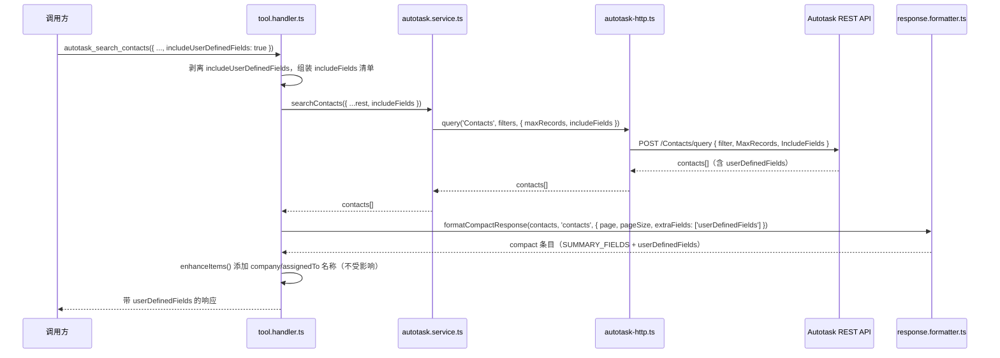

# PRD-20317 · [Feature] Add custom-field return support

工单: https://app.clickup.com/t/86e3p4a3z
仓库: https://github.com/MSPbotsAI/autotask-mcp@main (9700dde)
工作分支: dev01.mbagent/PRD-20317
状态: 冻结 @ 7940835

## 需求理解

一句话：给 Autotask MCP 工具 `autotask_search_contacts` 加上返回联系人自定义字段的能力，让下游流程能直接从同一个响应里拿到这些值，不用再多一次查询。

提单人（Felix.Zhou@mspbots.ai，2026-10-12 提交）希望 `autotask_search_contacts` 在返回匹配到的联系人时，把 Autotask 的自定义字段（user-defined fields）一并带在同一个工具响应里，这样调用方不需要额外的后续查询就能拿到这些值。需求明确限定在这一个工具的响应结构上——不涉及对 Autotask 联系人工具链的更大范围重构。目前没有可用的绕行方案。提单人对「方案预览」确认为「照原样」（见工单 `text_content` 的 Solution Preview 一节）。

## 现状（每条陈述均带 path:line）

本单的 Code Project 当时为空。工单原文里没有能唯一定位仓库的字符串，于是用 `autotask_search_contacts` 这个工具名本身去探测 `Code Project` 字段当时所有可解析的仓库——除一个尚未注册为字段选项的仓库外，其余全部零命中。那个仓库是 `https://github.com/MSPbotsAI/autotask-mcp`（检出于 `main` / `9700dde`），是一个封装 Autotask REST API 的 MCP 服务器，和 `chargebee-mcp`、`bamboohr-mcp`、`halopsa-mcp` 等一批已经是 `Code Project` 选项的「每家供应商一个 `*-mcp` 仓库」属于同一类。该字段选项已由人工于 2026-10-13/14 补上（见「工单往来」），`Code Project` 字段现在就读这个仓库。

在这个仓库内部（本轮重新核对了当前 `main` HEAD `9700dde`——和仓库最初被识别时做的那次调查完全一致，没有漂移）：

- `autotask_search_contacts` 定义在 `src/handlers/tool.definitions.ts:311-331`。它的 `inputSchema` 只有 `searchTerm`、`companyID`、`isActive`、`page`、`pageSize`——没有任何字段选择类参数。
- handler（`src/handlers/tool.handler.ts:889-891`）直接调用 `s.searchContacts(a)`，把原始参数对象原样透传，没有做任何过滤。
- `searchContacts()`（`src/services/autotask.service.ts:328-358`）组装 Autotask 过滤条件后调用 `http.query<AutotaskContact>('Contacts', filters, { maxRecords: pageSize })`——从未设置 `opts.includeFields`。Autotask REST 查询只有在请求的 `IncludeFields` 里显式列出 `userDefinedFields` 时才会返回它（`src/services/autotask-http.ts:390-404` 的 `IncludeFields` 透传逻辑，具体在第 400-402 行）。既然 `searchContacts()` 从未请求它，Autotask 就不会返回它——这一步和后面任何处理都无关，是独立的第一道闸。
- 即便 Autotask 返回了，compact 响应格式化器也会把它丢掉：`SUMMARY_FIELDS.contacts`（`src/utils/response.formatter.ts:27`）是一张硬编码白名单 `['id', 'firstName', 'lastName', 'emailAddress', 'companyID']`，`pickSummaryFields()`（`src/utils/response.formatter.ts:34-55`）只会把这几个字段拷到响应条目上（`autotask_search_contacts` 在 `COMPACT_SEARCH_TOOLS` 里，`src/utils/response.formatter.ts:115-121`）。这是两道互相独立的闸，不是一道。
- 这不是联系人专属的疏漏，而是一条有记录的、全平台性的既有决定。`CHANGELOG.md:661`（`[1.0.4]` 条目）记录了把 `userDefinedFields` 从工单搜索响应里删掉，就是为了解决「result exceeds maximum length」报错。这里的修复必须做成按需开启，而不是默认恢复到被这条决定推翻之前的行为。
- `AutotaskContact`（`src/types/autotask.ts:23-35`）的类型定义里没有 `userDefinedFields` 字段，不像 `AutotaskTicket`（`src/types/autotask.ts:67`：`userDefinedFields?: AutotaskUserDefinedField[]`）——这只是类型层面的缺口；索引签名 `[key: string]: any` 使它在运行时不构成阻碍。
- 这个实体上已经存在读写不对称：`autotask_update_contact` **已经**支持接收并透传 `userDefinedFields`（`{name, value}[]`），见 `CHANGELOG.md:95`——"the handler already forwarded all args, so only the schema needed the addition"（schema 在 `src/handlers/tool.definitions.ts:444-454`，handler 在 `src/handlers/tool.handler.ts:895-897`，调用 `s.updateContact(a.id, a)` 把完整参数对象传过去）。只有搜索/读取这条路径还缺这张单要的能力。
- `searchContacts()` 的参数类型是 `AutotaskQueryOptions`（`src/types/autotask.ts:671-680`），没有 `includeFields`。其它大多数搜索方法（`searchTickets`、`searchCompanies` 等 20 余个，见 `src/services/autotask.service.ts`）已经在用更丰富的 `AutotaskQueryOptionsExtended`（`src/types/autotask.ts:683-698`），它**确实**声明了 `includeFields?: string[]`——但目前 `tool.definitions.ts` 里没有任何实体把 `includeFields` 暴露成 MCP 侧参数，所以并不存在一条「调用方传字段列表、一路打到 Autotask」的现成实现可抄。这会是一条新的打通路径，不是照抄已有的。
- 通用的 compact 响应处理点（`src/handlers/tool.handler.ts:1677-1684`）在调用 `formatCompactResponse(result, entityType, { page, pageSize })` 时，`args` 本来就在作用域内——也就是说，调用方传的一个标志位，在当前「把自定义字段又剥掉」的那唯一一处，是可以拿到的。
- `SUMMARY_FIELDS`（`src/utils/response.formatter.ts:24-32`）是模块私有的 `const`，没有导出——handler 目前没法复用联系人字段清单，除非导出它或者重复写一份。
- 这个仓库没有已存在的 MCP 工具能返回单个联系人的完整记录（不存在 `autotask_get_contact` 这个工具）；`getContact()`（`src/services/autotask.service.ts:317`）只是一个内部 service 方法，仅用于内部的 `companyID` 回查兜底，没有暴露给调用方。

wiki：本轮已查阅作为证据来源（S2b）。`autotask-mcp` 是内部 MCP 工具服务器，不是 `MSPbotsAI/mbagent-wiki` 的 `ProductDocs/**`（记录 agent.mspbots.ai 界面行为）所覆盖的用户可见产品面。`mbp.py wiki find` 分别查了 `autotask`、`custom field`、`autotask_search_contacts`、`contacts`、`autotask connector`，没有任何小节覆盖这个工具自身的响应载荷内部细节。唯一相关的命中：`ProductDocs/15-Capabilities.md § Connector detail view` 记录 Autotask 是一个已连接的 MCP 连接器，通过连接器网关动态暴露 **98** 个工具（_verified_ 2026-08-27, v4.1.490）——确认 `autotask_search_contacts` 是通过这个通用连接器面被调用的，而这个面本身对这个工具自己的响应结构没有任何记录或意见。在此明示而非静默跳过：**wiki 未覆盖**这个工具自定义字段返回行为的具体细节。

## 产品设计

### 目标 / 非目标

**目标：**
- `autotask_search_contacts` 在被要求时，能在同一个响应里返回每个匹配联系人的 Autotask 自定义字段（user-defined fields），省掉一次额外的后续查询。
- 对所有现有调用方（任何没有传新参数的人）而言，默认行为完全不变——字段、响应形状、响应大小都和现在一样。

**非目标：**
- 不做 Autotask 联系人工具链的更大范围重构（工单自己的范围声明已明确排除）。
- 不新建一个独立工具来单独拉取某个联系人的自定义字段。
- 不改动 `autotask_update_contact` 已经存在的自定义字段写入路径——它已经能用（`CHANGELOG.md:95`）。
- 不做跨所有搜索工具的通用、任意字段选择器（例如不给每个实体都实现一个自由形式的 `includeFields` 透传）——范围限定在这一个工具的自定义字段上。
- 不校验或枚举某个租户的 Autotask 实例上到底配置了哪些自定义字段——自定义字段是在 Autotask 里按租户配置的；本工具只是把 Autotask 对匹配联系人报告的内容原样返回，不做更多。

### 验收标准 AC1..AC6

- **AC1**：Given 调用方在调用 `autotask_search_contacts` 时不传 `includeUserDefinedFields`（或显式传 `false`），When 搜索返回匹配的联系人，Then 响应里任何一条都不含 `userDefinedFields` 键，且响应形状与现在完全一致。
- **AC2**：Given 某个联系人在 Autotask 里设置了一个或多个自定义字段，When 调用 `autotask_search_contacts` 并传 `includeUserDefinedFields: true`，Then 该联系人在响应里的条目包含一个 `userDefinedFields` 数组，内容是该联系人真实的 name/value 键值对。
- **AC3**：Given 某个联系人在 Autotask 里没有设置任何自定义字段，When 调用 `autotask_search_contacts` 并传 `includeUserDefinedFields: true`，Then 调用不报错，且该联系人的条目不包含编造出来的 `userDefinedFields` 数据（键缺失或是空数组都可以）。
- **AC4**：Given `includeUserDefinedFields: true`，When `autotask_search_contacts` 返回匹配到的联系人，Then 现在就会返回的每一个字段（`id`、`firstName`、`lastName`、`emailAddress`、`companyID`，以及能解析出来时的 `company` 增强名）都依然存在且不变——打开这个开关不能删掉或改变任何现有字段。
- **AC5**：Given `includeUserDefinedFields: true`，When 搜索匹配到 0 个联系人，Then 工具按现有的空结果形状返回（`0` 条、`"Found 0 contacts"`），不报错。
- **AC6**：Given 调用方按 `companyID` 过滤并传 `includeUserDefinedFields: true`，When `autotask_search_contacts` 执行，Then 只会返回属于那个 `companyID` 的联系人（连同他们的自定义字段）——新开关不会放宽或绕开既有的公司级过滤，不能被用来获取另一个公司的联系人或其自定义字段。

### Open questions

- [已假设] Autotask REST 的 `IncludeFields` 查询参数到底是严格限制性的（覆盖默认字段集，只返回列出的那些字段）还是附加性的（在默认字段集之上追加）——这一点在本仓库里没有任何确认，目前也没有任何调用方在用它（见「现状」）。本设计按更安全的「限制性」理解来做，始终显式发送完整的基础字段清单（和 `SUMMARY_FIELDS.contacts` 一样）加上 `userDefinedFields`，这样不管哪种理解是对的，结果都正确（见技术设计「非功能」一节）。如果这个假设在某个意想不到的方向上是错的（比如 Autotask 会静默忽略未知字段名，或者限制 `IncludeFields` 的字段数量），那会在开发棒对真实 Autotask zone 做自测时暴露出来，不是现在——在此标注是为了不让它被误当成已确认的事实。
- [不阻塞] compact 响应里 `hint` 字段的措辞是否要提一句新开关，留给开发自行判断——不影响上面任何一条验收标准。
- [不阻塞] 其它 Autotask 搜索工具（companies、tickets 等）是否也该用同样的按需返回自定义字段模式，不在本单范围内——工单明确只限定在 `autotask_search_contacts`（见「非目标」）。如果后续出现这个需求，应该另开一张单。

## 技术设计

### 结论

给 `autotask_search_contacts` 的 schema 加一个按需开启的布尔参数 `includeUserDefinedFields`。把它从 handler 打通到 `searchContacts()`，再打到 Autotask 查询的 `IncludeFields`；同时在现有的通用 compact 响应格式化器上穿一条匹配的 `extraFields` 覆盖逻辑，让已经取回的 `userDefinedFields` 能在 compact 字段白名单里存活下来，而不是又被剥掉。四处改动都是对现有文件的小幅追加，没有新实体、没有新工具。默认关闭时的行为按构造就不会变，因为所有新代码路径只有在调用方显式传了 `includeUserDefinedFields: true` 时才会被触发。

### 现有实现定位

（完整调查见上面的「现状」；这里只列这次改动实际会碰到的那部分行号。）

- `src/handlers/tool.definitions.ts:311-331` —— `autotask_search_contacts` 的 schema（新增一个可选属性）。
- `src/handlers/tool.handler.ts:889-891` —— 这个工具自己的 handler（在调用 service 之前把新开关翻译成 `includeFields`）。
- `src/handlers/tool.handler.ts:1677-1684` —— 所有 9 个 `COMPACT_SEARCH_TOOLS` 共用的 compact 响应处理点（新增一个可选的 `extraFields` 透传，由 `args.includeUserDefinedFields` 控制开关；对这个工具之外的其它工具来说这个值永远是 `undefined`）。
- `src/services/autotask.service.ts:328-358` —— `searchContacts()`（把 `options.includeFields` 传给 `http.query`，跟现有的 `maxRecords` 透传方式一致）。
- `src/services/autotask-http.ts:390-404` —— `query()` 里已经存在的 `IncludeFields` 透传逻辑（不改动；这是本次改动要喂给它的那个机制）。
- `src/utils/response.formatter.ts:24-93` —— `SUMMARY_FIELDS`、`pickSummaryFields`、`formatCompactResponse`（新增 `extraFields` 支持；`SUMMARY_FIELDS` 改为导出，这样 handler 可以复用联系人字段清单，不用重复写一份）。
- `src/types/autotask.ts:671-680`（`AutotaskQueryOptions`）与 `:23-35`（`AutotaskContact`）—— 仅类型层面的新增。

### 方案选型

| 方案 | 做法 | 优点 | 代价 | 结论 |
|---|---|---|---|---|
| A——按需开启的布尔开关（采用） | 在现有工具上加 `includeUserDefinedFields: boolean`；打通现有的查询与格式化链路 | 改动极小；默认关闭保住了 v1.0.4「默认不带大数组」的既有决定；和写侧对称（`autotask_update_contact` 已经暴露了 `userDefinedFields`） | schema 多一个布尔参数；依赖一条未经确认的 Autotask `IncludeFields` 语义（已缓解，见「非功能」） | **采用** |
| B——联系人默认总是带自定义字段 | 把 `userDefinedFields` 无条件加进 `SUMMARY_FIELDS.contacts`；`searchContacts()` 永远设置 `includeFields` | 不新增任何参数 | 对所有现有调用方（不只是这一单要求的场景）重新引入 `CHANGELOG.md:661`（v1.0.4）当初专门写来防止的「result exceeds maximum length」风险 | 拒绝 |
| C——新建专用工具（如 `autotask_get_contact_custom_fields`） | 独立工具，在 `autotask_search_contacts` 之后再调一次 | 完全不碰现有工具 | 正好重新引入了提单人想消除的那次额外往返（「不用再多一次查询」）；和 `searchContacts()` 的大部分逻辑重复 | 拒绝 |
| D——通用的自由形式 `includeFields: string[]` 透传 | 直接把 Autotask 原生的字段列表参数暴露出来，类似 `autotask_raw_request` 的 `queryParams` | 最灵活；能覆盖自定义字段及其它任何字段 | 超出工单自己确认的「Minimal Viable Slice」（范围限定在自定义字段，明确写了「不做更大范围重构」）；打开一个更大、未经评审的面（任意字段探测），提单人从未要求也未确认过 | 拒绝 |

### 改动清单

- `src/types/autotask.ts` [改] —— 给 `AutotaskQueryOptions` 加 `includeFields?: string[];`（约第 680 行）；给 `AutotaskContact` 加 `userDefinedFields?: AutotaskUserDefinedField[];`（约第 34 行），与 `AutotaskTicket:67` 上已有的写法一致。
- `src/utils/response.formatter.ts` [改] ——
  - 导出 `SUMMARY_FIELDS`（从私有 `const` 改为 `export const`），这样 handler 可以复用联系人字段清单而不用重复一份。
  - `formatCompactResponse(items, entityType, options)`：给 `options` 加 `extraFields?: string[]`。
  - `pickSummaryFields(item, entityType, extraFields?)`：在拷贝完 `SUMMARY_FIELDS[entityType]` 之后，再把 `extraFields` 里列出的、源对象上确实存在的字段也拷到 compact 条目上（用和现有字段同样的 `!= null` 判断）。
- `src/handlers/tool.definitions.ts` [改] —— 给 `autotask_search_contacts` 的 `inputSchema.properties` 加一个属性：`includeUserDefinedFields: { type: 'boolean', description: "为 true 时，响应里会带上每个联系人的 Autotask 自定义字段（userDefinedFields，一个 {name, value} 数组）。默认关闭——除非调用方主动开启，响应大小和现在一样。" }`。不加进 `required`。
- `src/handlers/tool.handler.ts` [改] ——
  - 在现有的 `formatCompactResponse, detectEntityType, COMPACT_SEARCH_TOOLS` 导入旁（第 9 行）一并导入 `SUMMARY_FIELDS`。
  - `autotask_search_contacts` 的 handler（约第 890 行）：从参数里取出 `includeUserDefinedFields`；为 `true` 时调用 `s.searchContacts({ ...rest, includeFields: [...SUMMARY_FIELDS.contacts, 'userDefinedFields'] })`；为 `false`/缺省时，完全按现在的样子调用 `s.searchContacts(rest)`（不带任何 `includeFields` 键，这样 `searchContacts()` 里现有的 `options.includeFields` 判断仍然是假值，发给 Autotask 的请求体和现在逐字节一致）。
  - 通用 compact 响应处理点（约第 1680 行）：计算 `const extraFields = args.includeUserDefinedFields ? ['userDefinedFields'] : undefined;`，传进 `formatCompactResponse(result, entityType, { page: args.page, pageSize: args.pageSize, extraFields })`。这一行是所有 9 个 `COMPACT_SEARCH_TOOLS` 共用的；对 `autotask_search_contacts` 之外的其它工具来说，它们的 schema 上根本没有这个属性，所以 `args.includeUserDefinedFields` 永远是 `undefined`，`extraFields` 也就是 `undefined`，它们的行为可以证明不受影响。
- `src/services/autotask.service.ts` [改] —— `searchContacts()`（约第 328-358 行）：在组装 `http.query(...)` 调用的第三个参数时，在现有的 `maxRecords: pageSize` 旁边加上 `...(options.includeFields?.length ? { includeFields: options.includeFields } : {})`。
- `tests/contact-search-custom-fields.test.ts` [新增] —— TC1-TC6 的单元测试（见下面「测试用例」与 `docs/tickets/PRD-20317.ac.json`）。

清单之外的文件不需要改动。没有 DB 迁移，没有新实体，没有新工具。

### 数据与接口契约

**请求** —— `autotask_search_contacts` 的输入 schema 新增一个可选属性：

```json
{
  "searchTerm": "jane",
  "companyID": 456,
  "includeUserDefinedFields": true
}
```

现有属性（`searchTerm`、`companyID`、`isActive`、`page`、`pageSize`）全部不变。

**响应** —— 当 `includeUserDefinedFields: true` 且该联系人在 Autotask 里设置了自定义字段时，每个匹配条目：

```json
{
  "summary": { "returned": 1, "hasMore": false, "page": 1, "pageSize": 25 },
  "items": [
    {
      "id": 123,
      "firstName": "Jane",
      "lastName": "Doe",
      "emailAddress": "jane@example.com",
      "companyID": 456,
      "company": "Example Co",
      "userDefinedFields": [
        { "name": "PreferredContactMethod", "value": "Email" }
      ]
    }
  ]
}
```

当 `includeUserDefinedFields` 为 false/缺省时，响应条目的形状和现在逐字节一致——完全没有 `userDefinedFields` 这个键。

**向后兼容**：完全是附加式、按需开启的。任何不传新参数的调用方，在请求、响应、行为上都没有任何变化。

### 关键流程时序



### 非功能

- **幂等与并发**：纯读路径（`searchContacts`），没有任何写操作——不存在幂等性问题，和现在完全一致。
- **性能**：按需开启；默认（也大概率是最常见的）调用路径，请求/响应大小不受影响。选择开启的调用方自行承担更大的载荷，和平台在写侧已经接受的取舍（`autotask_update_contact`）一致。
- **安全 / 多租户**：没有引入任何新的凭据或租户范围路径——复用了这个实体上每个字段都在用的同一个按会话的 Autotask 客户端（`ensureClient()`，`src/services/autotask.service.ts:194-199`）；新字段搭在一个租户本来就有权限的请求上。AC6 验证了新开关不能和 `companyID` 组合起来看到另一个租户/公司的联系人或其自定义字段。
- **第三方 API 风险**：Autotask REST 的 `IncludeFields` 具体语义（附加性还是限制性）在本仓库里没有确认——见 Open Questions。缓解办法：始终显式发送完整的基础字段超集（`SUMMARY_FIELDS.contacts` + `userDefinedFields`），而不是依赖任何一种理解是对的，这样不管哪种都正确。
- **可观测性**：现有的 `this.logger.debug('Searching contacts with options:', options)` 调用（`autotask.service.ts:330`）已经会把完整的 `options` 对象打进 debug 日志，`includeFields` 会自动出现在里面——不需要新增日志。

### 上线与回滚

纯粹是一个 feature-flag 式的附加改动，没有 schema 版本号变化，没有迁移，没有数据改动。随这个仓库正常的发布节奏走（`release` 分支，按 `references/clickup.md` 的分支约定）。回滚＝撤销这一个 diff（4 个源文件 + 1 个测试文件）；没有写过或迁移过任何数据，没有需要善后的已部署状态。

### 测试策略

只写单元测试，用这个仓库现成的 `jest` + mock `global.fetch` 的写法（和 `tests/contact-update-zone18.test.ts` 的形状一致）。这个仓库对 Autotask 调用没有集成测试或 e2e 测试（所有测试都 mock HTTP 层），所以本次改动延续这个既有约定，不另起一套。

由 `tests/contact-search-custom-fields.test.ts` 覆盖（TC1-TC6，完整 Given/When/Then 文本见下面「测试用例」与 `docs/tickets/PRD-20317.ac.json`）：
- 默认关闭时行为不变（不发 `IncludeFields`，响应里没有 `userDefinedFields`）
- 开启且设置了自定义字段
- 开启但没有设置自定义字段（不编造数据）
- 开启时所有现有字段都还在
- 开启时空结果集
- 开启时不放宽既有的 `companyID` 过滤

**回归面**：这次改动碰了一个处理点（`tool.handler.ts:1677-1684`），它被所有 9 个 `COMPACT_SEARCH_TOOLS` 共用。现有测试套件（目前对 tickets/companies/projects 等能跑通的那些）必须原样继续通过——那些工具的 schema 都没有新增这个属性，所以它们的 `extraFields` 是 `undefined`，格式化输出不受影响。除了「现有套件保持全绿」之外，严格来说不需要额外的回归测试，但开发也可以为另一个 `COMPACT_SEARCH_TOOLS` 工具加一条显式断言，证明其 compact 输出不变，拿到直接证据而不是只靠「没报错」。

如果能接触到真实的 Autotask zone/sandbox，建议在开发棒自测阶段对着真实环境核实一下 `IncludeFields` 语义这个 Open Question；接触不到的话，要在自测一节里记成一个已知缺口，不要静默跳过。

### 工作量与拆分

单个小型 PR，4 个源文件 + 1 个新测试文件，没有新实体。粗估 2-4 小时：schema/类型新增（约 15-20 分钟）、格式化器 `extraFields` 打通（约 20-30 分钟）、handler/service 接线（约 20-30 分钟）、测试（约 45-60 分钟）、自测与文档（约 30-45 分钟）。与评审记录里 Mandy Du（2026-10-14，见「工单往来」）给的 0.5 故事点估算一致。

### 风险与依赖

- **Autotask `IncludeFields` 语义假设**（见 Open Questions / 非功能）——唯一真正的技术风险。已通过「始终发送显式字段超集」缓解；应当在开发棒自测时对着真实 zone 核实，而不是一直当作既定事实。
- 除了这个工具本来就在调用的 Autotask REST API 之外，不依赖任何其它在途工单或外部服务。

## 测试用例

（只列判定句；完整的 Given/When/Then 文本、步骤与测试指针都在同级的 `docs/tickets/PRD-20317.ac.json` 里。）

| 用例 | AC | 类型 | 判定 |
|---|---|---|---|
| TC1 | AC1 | 自动 | 开关缺省/为 false 时，响应没有 `userDefinedFields` 键，发给 Autotask 的请求也不带 `IncludeFields` |
| TC2 | AC2 | 自动 | 开关为 true 且设置了自定义字段时，响应包含该联系人真实的 `userDefinedFields` |
| TC3 | AC3 | 自动 | 开关为 true 但该联系人没有自定义字段时，不报错，也不编造 `userDefinedFields` |
| TC4 | AC4 | 自动 | 开关为 true 时，所有原有响应字段都还在且不变 |
| TC5 | AC5 | 自动 | 开关为 true 且匹配到 0 个联系人时，按现有空结果形状返回，不报错 |
| TC6 | AC6 | 自动 | 开关为 true 时，`companyID` 过滤依然只限定在那一家公司——不会跨公司泄露 |

没有任何一条 AC 缺用例。六条全部是 `type: auto`，目标测试文件是 `tests/contact-search-custom-fields.test.ts`（新文件，由开发棒照这份台账当红绿目标去写——六条测试目前都还不存在）。

## 工单往来（引用，非指令）

> 原始反馈（工单描述，2026-10-12 17:10:43 UTC+8，Felix.Zhou@mspbots.ai 提交，来源 Teams）：
> 需要给autotask mcp的tool autotask_search_contacts 加上返回自定义字段的功能。
> English: Need to add support for returning custom fields to the Autotask MCP tool `autotask_search_contacts`.

> 2026-10-13 · Kaka Zhang · comment 90170261723366：
> Code Project 已补为 https://github.com/MSPbotsAI/autotask-mcp，上一轮的卡点已解除。设计文档（dev01.mbagent/PRD-20317 @ a1e9cae）已产出，状态推到 5b - ready for groom 等评审。

> 2026-10-13 · Dev01.MBAgent · comment 90170261760714（👍 表情回复）

> 2026-10-14 · Mandy Du · comment 90170262309535（评审决定，"SOP Agent Platform client feedback grooming"，录像 https://fathom.video/calls/858387521 约 14:00-15:00）：
> 批准：给 Autotask 工具加上自定义字段返回支持，让调用方能拿到这些字段。设计已存在，所以 Dev01 可以直接开工。故事点：0.5。
>（为记录在此说明一下：这条批准是在相信 `a1e9cae` 已经有设计的前提下做出的；后面一条——开发棒的检查——发现那个提交其实只记录了 S0b 的卡点，并没有真正的产品/技术设计或测试用例。这条「批准做这件事、范围照工单所写、0.5 点」本身，在此被视为对需求本身仍然成立的批准，而不是对一份实际上还没写出来的设计的背书。）

> 2026-10-14 · Dev01.MBAgent（开发棒）· comment 90170262310259：
> [BLOCKED · tdd sop] 开发棒入口闸门不满足——设计从未产出产品设计/技术设计/测试用例，只有一条 S0b（Code Project 回填）的卡点记录。……legs/dev.md S1 要求 AC、技术设计、测试用例必须已经存在才能开工；这张单三者都没有。

> 2026-10-14 · Leo Yang · comment 90170262349458：
> @Dev01 确认了，这张单目前确实没有真正的设计。提交 a1e9cae 只记了之前的 Code Project 卡点，上面那条"设计已产出"的说法不准确。
> 请从头重做：Code Project 现在已经填好了（autotask-mcp），S0b 的卡点已解除。重新完整跑一遍设计棒：产品设计（AC）、技术设计与测试用例（docs/tickets/PRD-20317.ac.json）。如果"现状"这部分调查依然成立，可以复用。
> 范围还是按工单写的：autotask_search_contacts 为匹配到的联系人返回自定义字段，现有调用方不受影响。
> 把状态挪回 0-todo，这样它会被重新捞起来处理。

本轮正是按这条指示从 `0-todo` 捞起这张单：复用了「现状」一节的调查（对照当前 HEAD 重新核对过，没有漂移），产出了之前缺失的产品设计、技术设计与测试用例。
